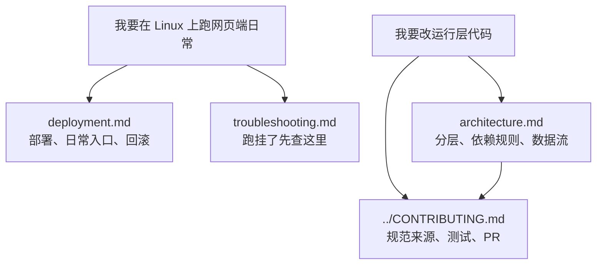

# 云·终末地网页端文档

本目录是 [`web/`](../README.md) 的文档索引。运行层代码在 `web/linux/`，资源覆盖层在 `assets/resource_cloud_web/`，两边的文档都从这里进。

## 阅读路线

建议顺序：

1. 第一次接触，先看 [`../README.md`](../README.md) 的架构图与状态矩阵，弄清「哪些能用、哪些还没通过」。
2. 要在机器上部署或改成定时任务 → [`deployment.md`](./deployment.md)。
3. 跑起来报错、节点不命中、agent 连不上 → [`troubleshooting.md`](./troubleshooting.md)。
4. 要改代码、加节点、提 PR → 先读 [`architecture.md`](./architecture.md)，再读 [`../CONTRIBUTING.md`](../CONTRIBUTING.md)。

> [!WARNING]
> 改 `web/linux` 前先读 [`architecture.md`](./architecture.md) 的分层规则。`core` 一旦 import `maa`，离线单测就全废，这是本项目最容易犯的错。

## 文档索引

### 入门

| 文档 | 说明 |
| --- | --- |
| [总览](../README.md) | 架构图、安装、跑法、状态矩阵、与上游的关系 |
| [部署](./deployment.md) | 发行版 + 本仓库的部署形态、日常入口、自动更新、回滚、故障恢复 |
| [排障](./troubleshooting.md) | 症状 → 诊断命令 → 结论 |

### 参考

| 文档 | 说明 |
| --- | --- |
| [架构](./architecture.md) | 分层与依赖规则、资源分层、数据流、选型镜像表 |
| [覆盖层节点说明](./overlay-desc-notes.md) | 每个覆盖节点为什么存在、改了哪条判据；`desc` 只留一句话，长文在这里 |
| [CDP 原生帧方案](./cdp-native-capture.md) | 抓帧链路实测、`CdpController` 设计、验收结果与代价 |
| [环境监测失败归因](./env-monitoring-failure-attribution.md) | `EnvironmentMonitoring` 的失败定位过程与结论 |
| [变更留档](../CHANGELOG-web.md) | 按日期记录改动、实测数据与踩过的坑 |

### 历史与过程记录

| 文档 | 说明 |
| --- | --- |
| [本轮契约（2026-11-04）](./project-20261104/PLAN.md) | 六组子任务的文件所有权、目标结构与验收标准 |
| [第一轮契约](./refactor-20261104/PLAN.md) | 运行层拆包与合并两条线的方案（已完成） |
| [重构前行为基线](./refactor-20261104/BASELINE.md) | 重构验收的黄金基线：同命令逐字一致 |
| [覆盖层审计](./refactor-20261104/PIPELINE-AUDIT.md) | 两层 pipeline 覆盖与任务文件的逐条核对 |

### 诊断

| 文档 | 说明 |
| --- | --- |
| [诊断索引](./diagnostics/README.md) | 证据分级（`static` / `log` / `needs-live`）与两个只读诊断脚本的用法 |
| [AutoEssence 0/8](./diagnostics/autoessence-0of8.md) | 基质链的根因排序与验证命令 |
| [导航 trigger point](./diagnostics/navigate-trigger-point.md) | `target rect is empty` 的定位过程 |

## 快速跳转

| 我想做什么 | 该看哪里 |
| --- | --- |
| 在服务器上从零部署 | [`deployment.md`](./deployment.md) |
| 改成每天定时跑 | [`deployment.md#日常入口`](./deployment.md#日常入口) |
| 升级发行版后出问题 | [`deployment.md#自动更新与回滚`](./deployment.md#自动更新与回滚) |
| 任务失败 / 节点不命中 | [`troubleshooting.md`](./troubleshooting.md) |
| 加一个覆盖节点 | [`overlay-desc-notes.md`](./overlay-desc-notes.md) + [`../CONTRIBUTING.md`](../CONTRIBUTING.md) |
| 搞清哪个模块该写在哪一层 | [`architecture.md`](./architecture.md) |
| 查某次改动为什么这么做 | [`../CHANGELOG-web.md`](../CHANGELOG-web.md) |

## 维护约定

- 新增文档先在本页登记，再按上面的分组归档；文件名用小写与连字符。
- 本目录只有中文。`web/` 不在上游发布范围内，因此不做 `docs/zh_cn` / `docs/en_us` 的双语镜像。
- Markdown 按仓库根 `.markdownlint.json` 写，提交前跑 `pnpm exec markdownlint "web/**/*.md"`，保持零报错。
- `refactor-20261104/` 是历史留档，按原样保存，不追改格式，也不在里面追加新结论。
