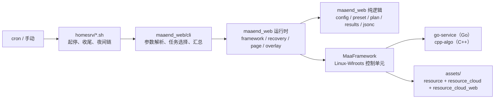

# 架构

本页说明 `web/` 运行层的分层、依赖规则、资源分层与一次运行的数据流。改动运行层代码前先读这里，尤其是「依赖规则」一节。  
最后更新：2026-11-04

## 1. 分层

| 层 | 位置 | 允许做什么 | 禁止做什么 |
| --- | --- | --- | --- |
| cli | `maaend_web/cli/` | 解析参数、选任务、调 runtime、汇总结果、决定退出码 | 写业务判定逻辑、直接碰 `maa` 句柄 |
| runtime | `maaend_web/*.py` | 与框架 / 浏览器 / CDP / 子进程交互，维护恢复与页面状态 | 在模块顶层 import `maa` |
| core | `maaend_web/*.py` | 纯计算：路径与环境变量、预设展开、任务选择、结果落盘、JSONC | import `maa`，读全局状态，做 I/O 之外的事 |

### 依赖规则

1. **单向依赖**：`cli → runtime → core`。反向 import 一律不允许。
2. **core 不 import `maa`**：`--help`、`--dry-run` 与全部单测因此不装框架就能跑。runtime 里的 `maa` 导入也只在函数体内，`TYPE_CHECKING` 除外。
3. **单一真源**：路径 / 端口 / 超时只在 `maaend_web/config.py`；ruff 规则只在 `pyproject.toml`；资源分层只在本页描述一次。
4. **生产入口路径不变**：`run_daily_linux.py`、`homesrv/*.sh` 的调用方式、环境变量名、退出码语义是兼容契约，改实现不改入口。
5. **不新增第三方运行期依赖**：运行期只用标准库 + 发行版自带的 `maa` 绑定（可选 `PIL`）。开发期可用 ruff、markdownlint 这类工具，但单测必须 `unittest` 可跑。

## 2. 一次运行的数据流

1. `homesrv/daily_run_homesrv.sh` 补齐会话变量、导出 `MAAEND_*`，然后调 `run_daily_linux.py`。
2. `maaend_web.config.load_settings()` 把这些环境变量拼成不可变的 `Settings`（根目录、资源层、日志目录、agent 路径、CDP 端口、wayland socket）。
3. `maaend_web.preset.load_preset()` 读 MXU 预设实例，把选项树展开成「任务 → entry + `pipeline_override`」，复现 GUI 的选项行为。
4. `maaend_web.plan.select_plan()` 按 `--tasks` / `--only` / `--from --to` 选出本次要跑的任务，序号与预设顺序一致。
5. `maaend_web.framework` 起控制器与 agent：`LD_PRELOAD` 自愈 → 连接 `Linux-Wlroots` → 启动 go-service 与 cpp-algo → 绑定 tasker。
6. 逐任务提交。失败先走 `recovery` 的恢复链（进世界判定、硬重置、失败现场帧），再按 `--attempts` 重试。
7. `maaend_web.results` 把逐项结果追加到 `probe_out/daily_linux_progress.jsonl`，结尾打印汇总与退出码。
8. `lib.sh` 注册的 `trap` 收尾：通知服务端结束会话 → 关 Chrome / agent / 合成器 → 打印残留计数（`chrome=0 agent=0 sway=0`）。

## 3. 资源分层

任务逻辑全在上游资源里，本仓库只加薄覆盖。挂载关系由 `assets/interface.json` 的 `controller[].attach_resource_path` 声明，不再靠 `MAAEND_RES_DIRS` 手工拼深层合并。

| 资源目录 | 来源 | 内容 |
| --- | --- | --- |
| `assets/resource` | 上游 base | 全部任务节点、模板、模型（720p 基准） |
| `assets/resource_cloud` | 上游云层 | 云端 UI 专属节点，很薄（实测 14 文件 / 27 节点） |
| `assets/resource_cloud_web` | 本仓库 | 网页端薄覆盖：启动链、退出链、颜色节点、云版传送链 |
| `assets/resource_linux` | 上游 Linux 层 | Linux 平台差异（实测 2 文件 / 7 节点） |

覆盖层的判断标准只有一个：**这条差异是网页端 / 云串流造成的**。属于上游 bug 的修，按「上游候选」标注并尽量回上游；本地改造留在覆盖层并写明原因（见 [`overlay-desc-notes.md`](./overlay-desc-notes.md)）。

任务定义与上游同目录：网页端的 `WebStartGame.json` 在 `assets/tasks/`，由 `assets/interface.json` 的 `import` 数组挂载。任务名、选项名必须同时进 `assets/locales/interface/*.json`，否则面板里只会显示原始键（`task.Xxx.label`）。

## 4. 选型镜像

同一种能力，上游用什么语言，我们就用什么语言，不自造替代实现。

| 能力 | 上游实现 | 语言 | 我们的做法 |
| --- | --- | --- | --- |
| 截图 / 输入 / 控制器 | `MaaLinuxControlUnit`（`WlrScreencap` / `WlrInput`） | C++ | 直接用框架的 `Linux-Wlroots` 控制器，不写 Python 主路径 |
| 寻路 / 移动 / 地图定位 | `agent/cpp-algo` 的 `MapNavigator` / `MapLocator` / `Navmesh` | C++ | 调 cpp-algo，不在 Python 里重写转向与寻路 |
| 图像识别 / 模板 / 颜色 | 框架 C++ + `IconRecognition` | C++ | 用 pipeline 节点或 cpp-algo 的自定义识别 |
| 业务动作 / 识别扩展 | `agent/go-service/<业务>/` | Go | 在 `agent/go-service/` 加包并在 `registerAll()` 注册 |
| 开发工具 / 数据生成 / 测试 | `tools/<Name>/` | Python | 工具类放 `tools/`，每工具一包 |
| 运行层编排（计划、恢复、配置） | 上游无对应物 | Python | 留在 `web/linux/maaend_web/`，并注明「无上游对应」 |

因此 `devtools/cdp.py`（云串流原生帧控制器）只是调试手段，**不是生产路径**：生产走 C++ 控制器，Python 侧只做编排与状态，不写像素与坐标计算。

## 5. 为什么 Python 侧还有恢复层

云会话比本地客户端多两类故障，pipeline 里没有等价节点：

- **会话掉回落地页**：云平台把会话回收后，画面回到启动页，后续节点全部空转。`recovery` 用页面状态机重新拉起登录链。
- **子场景退不出来**：WebView 里某些面板没有可识别的关闭按钮，ESC 连按又会在无按键响应的页面上空转。状态机按「当前是什么页面」决策，而不是按「点了几次」。

这两件事都是「编排」而不是「识别」，所以留在 Python；识别与点击仍然交回 pipeline 与框架。

## 6. 不做什么

- 不重写上游 `assets/resource/pipeline` 的任务逻辑，只通过覆盖层改差异节点。
- 不在 Python 里实现截图、输入、寻路、模板匹配。
- 不改 homesrv 生产环境的调用方式（环境变量名与入口路径是兼容契约）。
- 不为了跑通而加硬延迟：优先补中间识别节点或 `pre_wait_freezes`。
